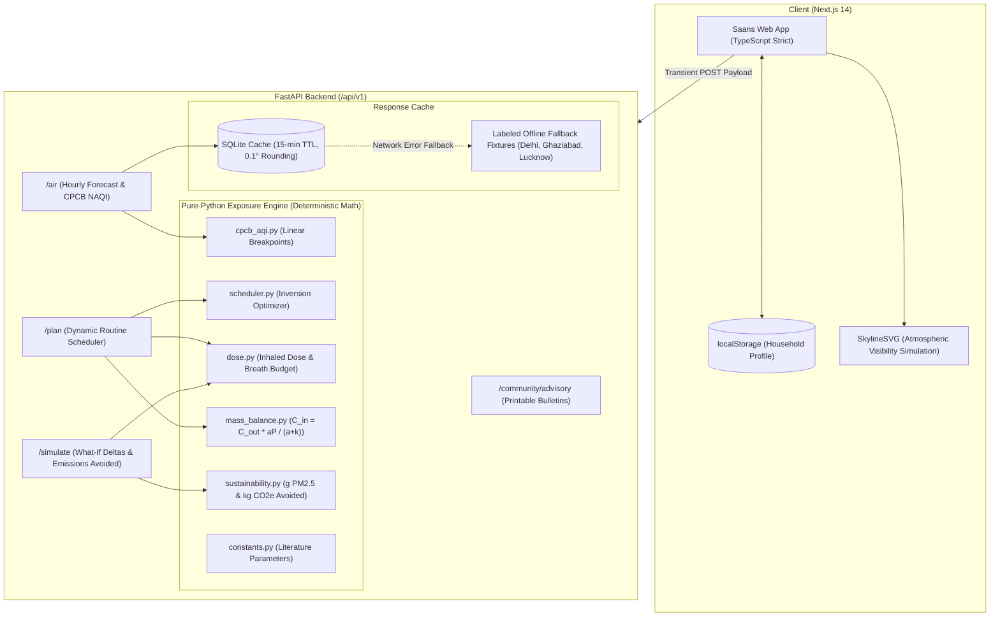

# साँस (SAANS) — Clean Air Assistant & Breath Budget Engine

> **A GenAI-powered web assistant helping Indian families and communities navigate severe winter smog and urban air pollution.**

[-brightgreen)](#)
[](#)
[](docs/AUDIT_2.md)
[](#)
[](#)
[](#)
[](#)

---

## 1. Problem Statement & Traceability

**Verbatim Hackathon Problem Statement:**
> *"Create a GenAI-powered assistant that helps families and communities navigate severe winter smog and urban air pollution. The application should suggest low-emission daily routines, indoor air quality hacks, and sustainable alternatives tailored to their location and lifestyle, while clearly explaining the direct impact of their choices."*

### Traceability Matrix

| Problem Statement Phrase | Fulfilling Feature | Implementation Module | Page / Interface |
| :--- | :--- | :--- | :--- |
| **"low-emission daily routines"** | Inversion-aware schedule optimizer shifting exercise, school runs, and airing | `apps/api/engine/scheduler.py` | `/your-day` |
| **"indoor air quality hacks"** | Door draft towels, wet mopping, window foam weatherstripping, CADR sizing | `apps/api/engine/mass_balance.py` | `/your-day`, `/simulate` |
| **"sustainable alternatives"** | Budget-tiered alternatives (₹0, <₹1k, >₹5k) with dual-lens emissions avoided (PM2.5 & CO2e) | `apps/api/engine/sustainability.py` | `/simulate` |
| **"tailored to location and lifestyle"** | Location-specific CPCB/Open-Meteo forecasts mapped to household age bands, commute modes, and housing types | `apps/api/services/air_service.py` | `/onboarding` |
| **"clearly explaining direct impact"** | The **Breath Budget** (micrograms inhaled, WHO & India NAAQS markers, and Berkeley Earth cigarette heuristic) | `apps/api/engine/dose.py` | `/your-day`, `/simulate` |
| **"families and communities"** | Multi-member household profiles, 200-household collective multipliers, and printable RWA/School advisory cards | `apps/api/routers/community.py` | `/community`, `/onboarding` |

---

## 2. Core Architectural Philosophy

### Cardinal Invariant: The LLM Never Does The Math
Large Language Models are non-deterministic and prone to calculation drift. In Saans:
1. **The pure-Python engine calculates every number:** Inhaled dose in micrograms, linear CPCB AQI sub-indices, room steady-state mass balances, Berkeley Earth cigarette-equivalents, schedule shifts, and rupee efficiency scores.
2. **The LLM formats and personalizes:** The AI layer receives structured tool output and narrates it in the user's language.
3. **Traceability is enforced:** Any numeric claim in an LLM reply is programmatically verified against tool outputs.

### Privacy by Design: Zero Server Persistence
- Household profiles (family ages, breathing sensitivity, commute modes, housing) reside strictly in browser `localStorage`.
- Transmitted as transient request data; never logged or saved to server disks.

---

## 3. System Architecture



---

## 4. Feature Flag Matrix (Addendum v2 Protocol)

All features meet the Section 8 quality bar or remain cleanly gated behind flags:

| Feature | Status | Flag Key | Description |
| :--- | :--- | :--- | :--- |
| **Landing ("Today's Air")** | 🟢 Live | Core | Skyline hero, CPCB AQI, one-sentence verdict, fallback banner |
| **Onboarding** | 🟢 Live | Core | Conversational setup, Ghaziabad demo persona, "Delete My Data" |
| **Your Day Dashboard** | 🟢 Live | Core | Hour-by-hour timeline, Breath Budget rings, ranked recommendations |
| **What-If Simulator** | 🟢 Live | Core | Interactive toggles, dual-lens emissions avoided, community scale |
| **Ask Saans (AI Assistant)** | 🟢 Live | Core | Grounded streaming chat, 10-year-old child mode, medical redline intercept |
| **Home Air Lab** | 🟢 Live | Core | CADR purifier sizing, room-by-room smog hacks, DIY Corsi-Rosenthal guide, myth-buster |
| **Community Advisory Card** | 🟢 Live | Core | Printable / shareable RWA & school bulletin in EN, HI, MR |
| **How Saans Works** | 🟢 Live | Core | Scientific formulas, parameter provenance, privacy disclosure |
| **Elder Mode** | 🟢 Live | Core | A+ toggle, large high-contrast typography and enhanced touch targets |
| **Station IDW Ward Map** | ⚙️ Flagged Off | `NEXT_PUBLIC_FF_WARD_MAP` | Managed via `apps/web/src/lib/flags.ts` (Roadmap) |
| **Route Comparison** | ⚙️ Flagged Off | `NEXT_PUBLIC_FF_ROUTE_COMP` | Managed via `apps/web/src/lib/flags.ts` (Roadmap) |
| **Client-Side Weekly Report**| ⚙️ Flagged Off | `NEXT_PUBLIC_FF_WEEKLY_REPORT`| Managed via `apps/web/src/lib/flags.ts` (Roadmap) |
| **Voice Speech API** | ⚙️ Flagged Off | `NEXT_PUBLIC_FF_VOICE` | Managed via `apps/web/src/lib/flags.ts` (Roadmap) |

---

## 5. Quickstart & Local Execution

### Prerequisites
- Python 3.12 or 3.13
- Node.js 18+ and npm

### One-Command Setup & Verification
```bash
# 1. Run all unit, API, and golden evaluation tests with coverage (29 tests, 31 evals, 73% coverage)
coverage run --source=apps/api tests/test_all.py && coverage report

# 2. Run Ruff lint check (0 errors, 0 warnings)
python -m ruff check apps/api tests

# 3. Export OpenAPI schema
python scripts/export_openapi.py

# 4. Run frontend tests and TypeScript verification
cd apps/web && npm test && npx tsc -p tsconfig.json --noEmit

# 5. Build Next.js Web App (11 static routes prerendered)
cd apps/web && npm run build
```

### Key Documentation Links
- **[Audit Remediation Record](docs/AUDIT.md)**: Line-by-line verification and fixes across all 12 external audit items.
- **[90-Second Hackathon Demo Script](docs/DEMO_SCRIPT.md)**: Rehearsed timeline and narrative track for the panel presentation.
- **[AI Layer Evaluation Harness](docs/EVALUATION.md)**: 31 golden questions, medical redlines, and prompt injection defense.
- **[Localization & Typography](docs/LOCALIZATION.md)**: EN, HI, MR dictionaries and Devanagari font rendering rules.
- **[Architectural Decisions (ADRs)](docs/DECISIONS.md)**: ADRs 1–6 covering pure-Python engine, local storage privacy, and CPCB breakpoints.
- **[Assumptions & Provenance](docs/ASSUMPTIONS.md)**: Literature sources for all coefficients and constants.
- **[Accessibility Audit](docs/A11Y.md)**: WCAG 2.2 Level AA compliance verification.

### Running Locally
```bash
# Terminal 1: Start FastAPI Backend (Port 8000)
python -m uvicorn main:app --app-dir apps/api --host 0.0.0.0 --port 8000 --reload

# Terminal 2: Start Next.js Frontend (Port 3000)
cd apps/web && npm run dev
```

Visit [http://localhost:3000](http://localhost:3000) in your browser.

---

## 6. Demo Persona Rehearsal Script (90 Seconds)

1. **Morning Severe Smog (0:00 - 0:20):**
   - Open Landing Page (`/`). Search any Indian city or click *"Recorded Demo Day"* to load Ghaziabad winter severe smog (AQI 492 Severe) and view the physical Koschmieder skyline haze extinction.
   - Note the transparent attribution ("Modelled estimate, not a ground station") and honest source indicator.
2. **Personalized Onboarding (0:20 - 0:35):**
   - Click *"⚡ Load Ghaziabad Demo Persona"* in `/onboarding`.
   - Loads 2 Adults, 9yo Aarav (breathing-sensitive), 68yo Dadi, petrol two-wheeler commute, and LPG cooking.
3. **Your Day Plan (0:35 - 0:55):**
   - View `/your-day`. Notice Aarav's Breath Budget (14.6× WHO limit, 10 cigs/day heuristic).
   - Review the Dynamic Scheduler shifting the morning walk from 7:00 AM (460 µg/m³) to 2:00 PM (160 µg/m³), avoiding peak thermal inversion (-65.2% exposure).
   - Review the Outdoor Worker Safety Protocol.
4. **What-If Simulation (0:55 - 1:15):**
   - Open `/simulate`. Toggle N95 mask + bedroom purifier + metro commute.
   - Dual-lens displays: -55% personal dose reduction side by side with 105.6g PM2.5 and 55.2kg CO2e avoided across 200 community households.
5. **Community Notice (1:15 - 1:30):**
   - Switch language to Hindi (हिन्दी) in `/community`.
   - Click *"Print / Export PDF"* to generate an authenticated RWA / School advisory card.
