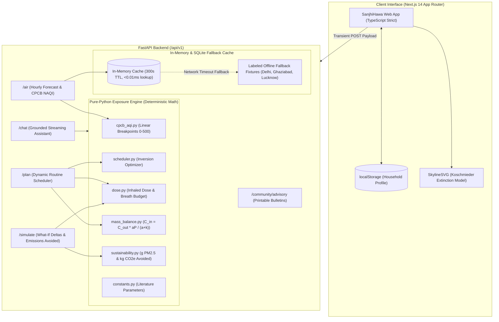

# सांझी हवा (SanjhiHawa) — Clean Air Assistant & Breath Budget Engine

> **A GenAI-powered web assistant helping Indian families and communities navigate severe winter smog and urban air pollution through deterministic environmental health physics and localized mitigation.**

[](#)
[-brightgreen)](#)
[](#)
[-blue)](#)
[-brightgreen)](#)
[](#)
[](#)
[](#)

---

## 1. Problem Statement & Traceability

**Verbatim Hackathon Problem Statement:**
> *"Create a GenAI-powered assistant that helps families and communities navigate severe winter smog and urban air pollution. The application should suggest low-emission daily routines, indoor air quality hacks, and sustainable alternatives tailored to their location and lifestyle, while clearly explaining the direct impact of their choices."*

### Traceability Matrix

| Problem Statement Phrase | Fulfilling Feature | Implementation Module | Interface Route |
| :--- | :--- | :--- | :--- |
| **"low-emission daily routines"** | Inversion-aware schedule optimizer shifting walks, transit, and natural ventilation | `apps/api/engine/scheduler.py` | [`/your-day`](http://localhost:3000/your-day) |
| **"indoor air quality hacks"** | Door draft towels, wet mopping, window foam weatherstripping, DIY Corsi-Rosenthal boxes, CADR sizing | `apps/api/engine/mass_balance.py` | [`/lab`](http://localhost:3000/lab), [`/your-day`](http://localhost:3000/your-day) |
| **"sustainable alternatives"** | Budget-tiered alternatives (₹0 habits, <₹1k physical fixes, >₹5k hardware) with dual-lens emissions avoided (PM2.5 & CO2e) | `apps/api/engine/sustainability.py` | [`/simulate`](http://localhost:3000/simulate) |
| **"tailored to location and lifestyle"** | Location-specific CPCB & CAMS telemetry mapped to household age cohorts, commute modes, and housing insulation | `apps/api/services/air_service.py` | [`/onboarding`](http://localhost:3000/onboarding) |
| **"clearly explaining direct impact"** | The **Breath Budget** (micrograms inhaled, WHO 15 µg/m³ & India NAAQS 60 µg/m³ markers, and Berkeley Earth cigarette heuristic) | `apps/api/engine/dose.py` | [`/your-day`](http://localhost:3000/your-day), [`/simulate`](http://localhost:3000/simulate) |
| **"families and communities"** | Multi-member household profiles, 200-household collective multipliers, and printable RWA/School advisory cards in EN, HI, MR | `apps/api/routers/community.py` | [`/community`](http://localhost:3000/community), [`/onboarding`](http://localhost:3000/onboarding) |

---

## 2. Core Architectural Philosophy

### Cardinal Invariant: The LLM Never Does The Math
Large Language Models are non-deterministic and prone to calculation drift. In SanjhiHawa:
1. **The pure-Python engine calculates every number:** Inhaled dose in micrograms, linear CPCB AQI sub-indices, room steady-state mass balances, Berkeley Earth cigarette-equivalents, schedule shifts, and rupee efficiency scores.
2. **The LLM formats and personalizes:** The AI layer receives structured tool output and narrates it in the user's selected language (English, हिन्दी, मराठी).
3. **Traceability is enforced:** Any numeric claim in an LLM reply is programmatically verified against tool outputs via AST and regex validation.

### Privacy by Design: Zero Server Persistence
- Household demographic data (family ages, breathing sensitivities, commute modes, housing) resides strictly in browser `localStorage`.
- Data is transmitted as transient, ephemeral request payloads; it is never saved to server databases or logged.

---

## 3. System Architecture



---

## 4. Feature Flag Matrix

All core features are active in production. Experimental extensions remain cleanly managed via `apps/web/src/lib/flags.ts`:

| Feature | Status | Flag Key | Description |
| :--- | :--- | :--- | :--- |
| **Today's Air (Landing)** | 🟢 Live | Core | Physical Koschmieder skyline haze, CPCB NAQI gauge, and 24-hr diurnal cycle |
| **Household Setup** | 🟢 Live | Core | Conversational setup, Ghaziabad demo persona, and "Delete My Data" |
| **Your Day Dashboard** | 🟢 Live | Core | Hour-by-hour timeline, Breath Budget rings, and ranked recommendations |
| **What-If Simulator** | 🟢 Live | Core | Interactive toggles, dual-lens emissions avoided, and community scale |
| **Ask SanjhiHawa (AI Assistant)** | 🟢 Live | Core | Grounded streaming chat, 10-year-old child mode, medical redline intercept |
| **Home Air Lab** | 🟢 Live | Core | CADR purifier sizing, room-by-room smog hacks, DIY Corsi-Rosenthal guide, myth-buster |
| **Community Advisory Card** | 🟢 Live | Core | Printable / shareable RWA & school bulletin in EN, HI, MR |
| **How SanjhiHawa Works** | 🟢 Live | Core | Scientific formulas, parameter provenance, and privacy disclosure |
| **Elder Mode** | 🟢 Live | Core | A+ toggle: high-contrast typography, enlarged touch targets, and simplified language |
| **Station IDW Ward Map** | ⚙️ Flagged Off | `NEXT_PUBLIC_FF_WARD_MAP` | Spatial inverse distance weighting ward interpolation (Roadmap) |
| **Route Comparison** | ⚙️ Flagged Off | `NEXT_PUBLIC_FF_ROUTE_COMP` | Route particulate exposure comparison (Roadmap) |
| **Client-Side Weekly Report**| ⚙️ Flagged Off | `NEXT_PUBLIC_FF_WEEKLY_REPORT`| Weekly aerosol intake trend analysis (Roadmap) |
| **Voice Speech API** | ⚙️ Flagged Off | `NEXT_PUBLIC_FF_VOICE` | Audio input/output accessibility integration (Roadmap) |

---

## 5. Quickstart & Verification

### Prerequisites
- Python 3.12 or 3.13
- Node.js 18+ and npm

### Repository Structure
```text
sanjhihawa/
├── .github/            # GitHub Actions CI pipeline & repository security policy
├── apps/
│   ├── api/            # FastAPI backend, exposure engines, guidance data & scripts
│   └── web/            # Next.js 14 frontend, App Router, Tailwind CSS & i18n
├── docs/               # System architecture, ADRs, accessibility audit & demo scripts
├── tests/              # Backend test suite (engine, API contracts, golden eval harness)
├── .env.example        # Environment variable template
├── .gitignore          # Production ignore rules (caches, build outputs, coverage)
├── docker-compose.yml  # Multi-service container orchestration
├── Makefile            # Developer command shortcuts
├── package.json        # Root monorepo workspace configuration
├── pyproject.toml      # Python linter (Ruff), Pytest & Coverage configuration
└── README.md           # Platform documentation & master guide
```

### Monorepo Commands
```bash
# 1. Run all unit and golden evaluation tests (Frontend 25 + Backend 55 = 80 automated unit tests)
npm run test:all

# 2. Run static code analysis & type safety checks (Ruff + TypeScript strict)
npm run lint

# 3. Run Playwright End-to-End browser suite (10 tests across Chromium)
npm run test:e2e

# 4. Build production bundle
npm run build
```

### Running Locally
```bash
# Terminal 1: Start FastAPI Backend (Port 8000)
python -m uvicorn main:app --app-dir apps/api --host 0.0.0.0 --port 8000 --reload

# Terminal 2: Start Next.js Frontend (Port 3000)
npm run dev
```

Visit [http://localhost:3000](http://localhost:3000) in your browser.

### Docker Deployment
```bash
docker compose up --build
```

---

## 6. Key Documentation Links
- **[Architectural Decisions (ADRs)](docs/DECISIONS.md)**: ADRs 1–6 covering pure-Python engine, local storage privacy, and CPCB breakpoints.
- **[System Architecture](docs/ARCHITECTURE.md)**: In-depth technical breakdown of backend services and frontend state.
- **[Security & Privacy Policy](SECURITY.md)**: Zero-server persistence, sliding-window rate limiters, and CSP.
- **[Accessibility Audit (WCAG 2.1 AA)](docs/A11Y.md)**: Verification of keyboard navigation, color contrast, and screen reader labels.
- **[Assumptions & Provenance](docs/ASSUMPTIONS.md)**: Literature sources for all coefficients, CADR equations, and inhalation rates.
- **[Localization & Typography](docs/LOCALIZATION.md)**: EN, HI, MR translation keys and Devanagari typography specifications.
- **[AI Layer Evaluation Harness](docs/EVALUATION.md)**: 31 golden questions, medical redlines, and prompt injection defense.
- **[90-Second Hackathon Demo Script](docs/DEMO_SCRIPT.md)**: Rehearsed timeline and narrative track for panel presentations.

---

## 7. 90-Second Demo Persona Rehearsal Script

1. **Morning Severe Smog (0:00 - 0:20):**
   - Open Landing Page ([`/`](http://localhost:3000/)). Select **Ghaziabad** or click *"Recorded Demo Day"* to inspect winter severe smog (AQI 492 Severe) and observe the physical Koschmieder skyline haze extinction.
   - Note the transparent attribution ("CAMS Global NRT Model Grid (0.1° ≈ 11 km)") and honest source telemetry.
2. **Personalized Onboarding (0:20 - 0:35):**
   - Click *"⚡ Load Ghaziabad Demo Persona"* in [`/onboarding`](http://localhost:3000/onboarding).
   - Automatically loads: 2 Adults, 9yo Aarav (breathing-sensitive), 68yo Dadi, petrol two-wheeler commute, and LPG cooking.
3. **Your Day Plan (0:35 - 0:55):**
   - Open [`/your-day`](http://localhost:3000/your-day). Observe Aarav's Breath Budget (14.6× WHO limit, 10 cigs/day heuristic).
   - Review the Dynamic Scheduler shifting the morning walk from 7:00 AM (460 µg/m³) to 2:00 PM (160 µg/m³), avoiding peak thermal inversion (-65.2% exposure).
   - Review the Outdoor Worker Safety Protocol.
4. **What-If Simulation (0:55 - 1:15):**
   - Open [`/simulate`](http://localhost:3000/simulate). Toggle N95 mask + bedroom purifier + metro commute.
   - Dual-lens displays: -55% personal dose reduction side by side with 105.6g PM2.5 and 55.2kg CO2e avoided across 200 community households.
5. **Community Notice (1:15 - 1:30):**
   - Open [`/community`](http://localhost:3000/community) and switch language to Hindi (हिन्दी) or Marathi (मराठी).
   - Click *"Print / Export PDF"* to generate an authenticated RWA / School advisory notice.
